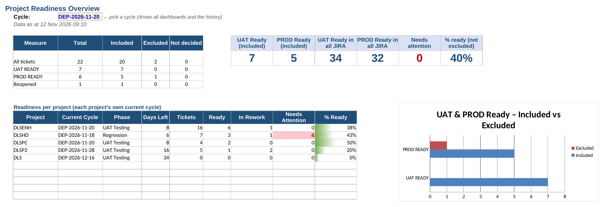

# JIRA Deployment Tracker for Release Management

An Excel-based tracking and monitoring system built during my practicum (SQQXK4946 Industrial Training, Universiti Utara Malaysia).

## What it does
- Paste the daily JIRA CSV export once — every sheet updates automatically
- Sorts each ticket into a testing stage using a status mapping table
- Shows which tickets are included in, excluded from or deferred to each release
- Flags tickets as Ready, Watch or Urgent based on each project's deployment date
- Keeps a daily history automatically (no macros)
- Seven health checks catch mistakes such as unknown statuses or duplicate tickets

## Files
| File | Description |
|---|---|
| `DLS_Deployment_Tracker_FINAL.xlsx` | The tracker, loaded with 3 days of dummy data. Start at the **About** sheet. |
| `*_DLS_Daily_extraction_DUMMY.csv` | The 3 dummy JIRA exports used for testing |

## Tools
Microsoft Excel — tables, INDEX/MATCH, COUNTIFS, IFS, AGGREGATE, data validation, conditional formatting, charts.

## Data notice
All data is **dummy test data**. "DLS" (Demo Loan System) is an invented system name and all people are fictional. No confidential data is included.

## Author
Caitlyn Chan Rou Qian — Bachelor of Science with Honours (Decision Science), Universiti Utara Malaysia
